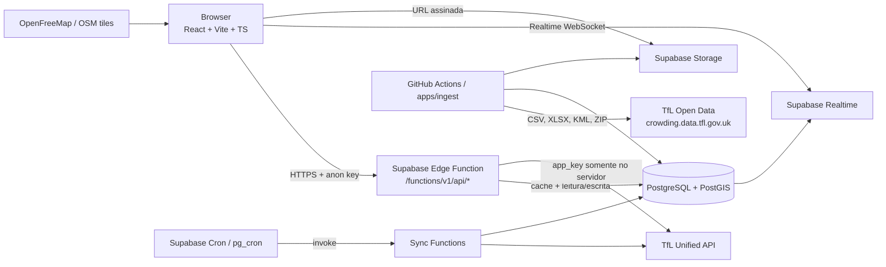

# Arquitetura — London Digital Twin

## Visão geral

O produto é um **digital twin operacional** do sistema metroferroviário de Londres. O MVP usa o mapa como superfície principal e uma API própria normalizada como única fronteira de acesso a dados externos.



## Decisões estruturais

| Decisão | Justificativa |
|---|---|
| Supabase Edge Functions como backend | Serverless, integrado ao Postgres/Realtime/Storage, sem servidor dedicado no MVP. |
| API própria normalizada | O frontend não conhece a TfL, não vê `app_key` e recebe metadados de frescura. |
| `packages/api-core` compartilhado | O mesmo router roda na Edge Function e num harness Node local (`apps/api`). A Edge Function é empacotada com esbuild (`index.bundle.js`) para eliminar imports fora da função. |
| `basePath = "/api"` na Edge Function | O runtime do Supabase inclui o nome da função no path (`/api/health`). O harness local usa `""`. |
| PostgreSQL + PostGIS | Consultas relacionais, histórico, índices GIST e exportação GeoJSON. |
| Cache em Postgres (`internal.api_cache`) | Compartilhado entre instâncias, sem dependência extra no MVP. Upstash pode entrar depois. |
| Ingestão pesada fora da Edge Function | CSV/XLSX/ZIP grandes são processados por `apps/ingest`/GitHub Actions. |
| OpenFreeMap como basemap | Sem chave, vetorial, compatível com MapLibre e com atribuição OSM. |

## Estrutura do monorepo

```text
apps/
  web/        React + Vite + TypeScript + MapLibre + TanStack Query
  api/        Harness local do backend (Hono + Node), usa o mesmo api-core
  ingest/     Catálogo e, futuramente, ETL dos datasets abertos
packages/
  shared/     Tipos, Zod, constantes, cores oficiais, severidade, datas
  api-core/   Router Hono, cliente TfL, cache, metadados e erros
supabase/
  migrations/ Schema, RLS, Realtime e Storage
  functions/  api (pública) e futuras sync-*
  seed/       Referência real (modos, linhas, cores, fontes, severidade)
```

## Fluxo de uma requisição

1. O browser chama `GET /functions/v1/api/health` (ou outro endpoint) com a anon key.
2. A Edge Function valida CORS, gera `requestId` e aplica logging estruturado.
3. O router consulta o cache Postgres.
4. Em cache miss, o cliente TfL chama a fonte com timeout e retry limitado.
5. A resposta é normalizada e devolvida com `data` + `meta`.
6. Em falha da TfL, o backend devolve o último cache válido com `dataSourceStatus = "stale"`.
7. Se não houver cache, devolve `503` com `data = null` e `dataSourceStatus = "unavailable"`.

## Contrato de metadados

Toda resposta segue:

```json
{
  "data": {},
  "meta": {
    "source": "tfl-unified-api",
    "fetchedAt": "2026-11-10T02:43:35Z",
    "cachedAt": "2026-11-10T02:43:36Z",
    "cacheTtlSeconds": 60,
    "isStale": false,
    "dataSourceStatus": "live",
    "ageSeconds": 12,
    "requestId": "req_...",
    "schemaVersion": "1.0",
    "dataQuality": "reported",
    "warnings": []
  }
}
```

Estados de `dataSourceStatus`: `live`, `cached`, `stale`, `unavailable`.

## Classificação do dado

| Classificação | Exemplo | Regra de UI |
|---|---|---|
| `reported` | Status de linha, disrupção, arrival | Mostrar timestamp da coleta. |
| `derived` | Status de estação, contagem de afetadas | Explicar a derivação. |
| `historical` | Footfall, RODS, crowding 2017 | Nunca rotular como tempo real. |
| `scenario` | Simulação de fechamento | Mostrar premissas e rótulo de cenário. |

## Segurança

- `TFL_APP_KEY` e `SUPABASE_SERVICE_ROLE_KEY` apenas em secrets de backend/Vault.
- Frontend usa somente `VITE_SUPABASE_URL` e `VITE_SUPABASE_ANON_KEY`.
- RLS habilitado em todas as tabelas públicas; escrita apenas com `service_role`.
- `internal.api_cache`, `internal.api_rate_limits` e `internal.raw_payloads` sem acesso público.
- CORS restrito a `ALLOWED_ORIGINS`.
- CSP no Cloudflare Pages/Netlify.
- Nenhum log contém `app_key`; o cliente TfL redige a URL.

## Fase 1 — entregue

- Monorepo npm workspaces.
- React/Vite/TS com layout CCO, mapa MapLibre e estados vazios honestos.
- `packages/shared` com contratos, cores oficiais, severidade e metadados.
- `packages/api-core` com router Hono, health, cache, logging e cliente TfL preparado.
- `apps/api` local em `http://localhost:8787`.
- Migrações Supabase com PostGIS, tabelas, índices, views, RLS, Realtime e Storage.
- Seed real de modos, 20 linhas, cores oficiais, severidade e fontes.
- Edge Function `api` com `/health`, empacotada por esbuild e validada no Supabase local.
- Configs de deploy Cloudflare/Netlify, CI, README e docs.

### Validações executadas na Fase 1

- `supabase start` + `supabase db reset` aplicaram as duas migrações e o seed.
- `GET /rest/v1/lines` com anon key devolveu 20 linhas.
- `api_cache` não é acessível via REST público.
- Trigger PostGIS criou `POINT(-0.12 51.5)` com SRID 4326.
- `v_line_status_current` escolheu o status mais severo do teste.
- `GET /functions/v1/api/health` devolveu `database: ok`, `cache: ok`.
- CORS rejeitou `Origin` não permitido com 403.

## Fase 2 — entregue

- Cliente TfL com validação Zod, timeout, retry, backoff e `app_key` redigida.
- `sync-reference`: modos, severidade, linhas, stop points, entradas, facilities, route sequences e geometria.
- `sync-status`: snapshots por linha + snapshot agregado da rede.
- `sync-disruptions`: normalização, estações afetadas e encerramento por inatividade.
- `sync-cleanup`: retenção de arrivals, cache, snapshots e jobs.
- Rotas: `/network`, `/network/status`, `/lines`, `/lines/:id`, `/lines/:id/status`,
  `/lines/:id/disruptions`, `/lines/:id/route`, `/lines/:id/stations`, `/stations`,
  `/stations/:id`, `/stations/:id/arrivals`, `/stations/:id/disruptions`, `/disruptions`,
  `/dashboard/summary`, `/sources` e `/sync/*`.
- Estações canónicas: plataformas tram convertidas para `stationNaptan`; hubs de interchange
  ignorados como estações.
- Frontend: CCO, dashboard, alertas, explorador e fontes já consomem os resumos reais.
- Geometria: `MultiLineString` por linha/direção; inbound é derivado por reversão no endpoint.

## Fase 3 — entregue

- `NetworkMap` desenha GeoJSON real: linhas MultiLineString e 509 estações.
- MapLibre v6 worker servido como estático (`apps/web/public/maplibre-gl-worker.mjs`,
  copiado por `scripts/copy-maplibre-worker.mjs`) e registado com `setWorkerUrl`.
- Camadas instaladas em `style.load` (não depender apenas de `map.load`/`idle`).
- Modo de cor oficial vs status; seleção com dimming; popup de hover.
- Clique em linha/estação; clique vazio limpa; flyTo para busca.
- Painéis de linha, estação e comparação de 2–3 linhas.
- Filtros de modo, banda, lifts, WC e WiFi.
- Busca com sugestões e deep links `?line=` / `?station=`.
- `GET /stations/:id` enriquece entradas/facilities via TfL on-demand, com cache de 24 h.

## Fase 4 — entregue

- Realtime: o browser subscreve `postgres_changes` em `line_status_snapshots`,
  `disruptions` e `network_status_snapshots`; as invalidações são agrupadas para
  evitar refetches por cada linha.
- O polling de 60 s mantém-se como fallback; `useRealtimeStore` expõe o estado
  `connecting | subscribed | error` para o badge do topo.
- `sync-status` chama `ldt_rollup_status_hourly`, que agrega as últimas horas em
  `network_status_hourly` / `line_status_hourly` (particionadas por mês).
- Cada bucket horário representa o snapshot mais recente da hora, para que as
  contagens por banda somem sempre `lines_total`.
- `/dashboard/history` devolve série de 6/24/72 h e top linhas por buckets com
  disrupção; `/data-health` e `/jobs` expõem fontes, jobs e retenção.
- `ldt_apply_retention` centraliza a limpeza de snapshots, cache, jobs e partições
  horárias antigas.
- Dashboard com gráficos Recharts e jobs; alertas com filtros reais.
- As tabelas de snapshots em tempo real não foram convertidas em particionadas:
  tal exigiria `captured_at` nas chaves únicas e poderia afetar a publicação
  Realtime. A retenção de 90 dias limita o crescimento; o particionamento foi
  aplicado aos agregados horários.

## Fase 5.1 — entregue

- `apps/ingest` descarrega o CSV de footfall diário da TfL, resolve nomes para
  estações canónicas (`STATION_ALIASES` + normalização + sufixos de modo) e faz
  upsert em `station_traffic_snapshots` (`granularity = daily`, dataset
  `tfl-station-footfall-2025-2026`). Nomes não resolvidos são reportados, nunca
  inventados.
- O grafo é derivado de `line_stations` (ordem outbound) e de transferências
  entre estações com o mesmo `hub_naptan_code`.
- `packages/api-core/src/analytics` contém os algoritmos puros: componentes,
  articulações (Tarjan), cenários de remoção e resumo de acessibilidade.
- `/analytics/network`, `/analytics/scenarios` e os endpoints de footfall usam
  `dataQuality = derived | scenario | historical` e premissas explícitas.
- Página `/analytics`: KPIs, facilities, articulações, impacto por linha,
  simulador e séries históricas. Recharts é carregado com esta rota.

## Fase 5.2 — entregue

- Annual station counts 2025 (`tfl-annual-station-counts-2025`) em
  `station_traffic_snapshots` com `granularity = annual`.
- NUMBAT 2016–2025 em `line_annual_boardings`; `HAM` (H&C + Circle) fica sem
  `line_id` por representar duas linhas em conjunto.
- Link flows 2017 agregados por estação/intervalo em
  `station_crowding_profiles` (`kind = link_flow`).
- Train loading 2017 por ligação linha–estação/intervalo (`kind = train_loading`).
- Endpoints `/analytics/annual/summary`, `/analytics/boardings` e
  `/analytics/crowding/stations/:id`; UI com annual counts, NUMBAT e perfil
  típico de crowding.
- Limitações: RODS 2017 (`.xls` com pesos) fica para 5.3; a sequência “Regular”
  da TfL omite 3 paragens de tram, que permanecem isoladas; não há tempos de
  viagem/frequências.

## Fase 5.3 — entregue

- RODS 2017: descarrega o ZIP oficial, extrai o `.xls` de boarders/alighters
  (`Boarders` e `Alighters`) e lê as 84 colunas de 15 minutos com SheetJS.
- Resolução line-aware: Hammersmith, Edgware Road e Paddington escolhem a
  estação canónica certa conforme a linha; `Bank / Monument` é mapeado para Bank.
- 121 716 perfis em `station_crowding_profiles` (`kind = entry_exit`,
  `profile_name = RODS 2017 boarders|alighters`), 267 estações.
- `/analytics/rods/stations/:id?metric=boarders|alighters` e painel na página
  `/analytics` com toggle de métrica.
- Escala tipográfica global: `html { font-size: 18px }`; tamanhos arbitrários
  passaram de px para rem e os ticks dos gráficos foram aumentados.
- Limitações: RODS é uma estimativa ponderada de 2017; não é tempo real. Tempos
  de viagem/frequências e as 3 paragens de tram continuam sem fonte.

## Fase 6 — entregue

- Supabase Auth com sessão persistente no cliente (`persistSession`,
  `autoRefreshToken`). `profiles` é criado por trigger a partir de `auth.users`.
- `user_favorites` e `user_alert_subscriptions` com RLS `auth.uid() = user_id`;
  `is_admin` só é alterável com service_role.
- `/account` (login/registo, favoritos, subscrições e notificações), `/admin`
  (read-only, fontes/jobs/retenção) e `/report` (impressão/PDF do browser).
- Notificações do browser via `useBrowserAlerts`; não há push server-side.
- `london-boroughs.geojson` (33 boroughs ONS, OGL v3.0) é servido localmente e
  ativado por toggle no CCO. PTAL não foi incluído por falta de fonte validada.
- Escala tipográfica global: `html { font-size: 18px }`; classes arbitrárias
  convertidas para rem e ticks de gráficos aumentados.

## Próximas fases

Ver `docs/roadmap.md` e `docs/cron.md`.

